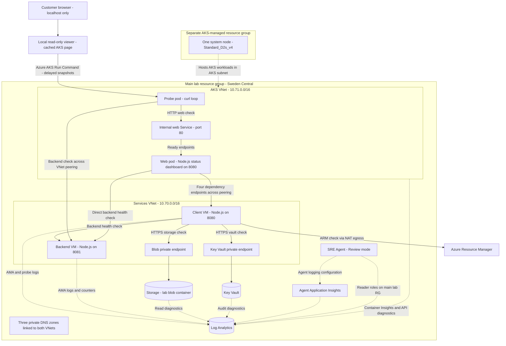
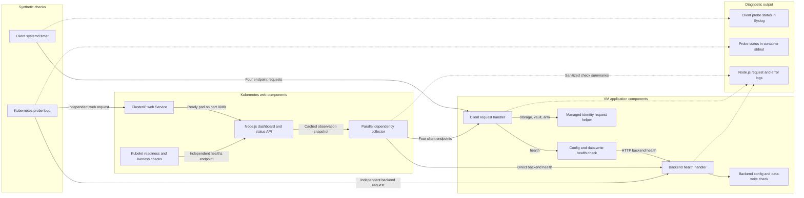

# Architecture Diagram

Current SRE Day lab architecture as of 2026-09-15. The Node.js frontend now has an independent operations observer in the local viewer, alongside the application paths shown below. All 28 additional fault scripts are implemented; live evidence is tracked separately in [the scenario guide](../../../../../SCENARIOS.md). Agent investigation remains unverified. See [the full architecture](../../../../../ARCHITECTURE.md) and [demo guide](../../../../../DEMO.md).

The viewer also reads VM power through ARM, measures backend resources and AMA through VM Run Command, checks namespace operator authorization with an isolated token, reads web deployment status, and queries Log Analytics for both expected VM heartbeats. These are observer paths, not new application dependencies. The top operational summary can be red while all six application requests remain healthy. No browser or web-pod Azure credentials were added.

## Application Architecture

Solid arrows represent configured workload paths. Dotted arrows represent telemetry or configured management scope, not automatic remediation.

<!-- mermaid-checked: no \n, no em-dash/en-dash, no {} in labels, subgraphs are id["label"], arrows are -->|"label"|, all subgraphs closed by end, ids unique -->

### Technology Stack Summary

| Layer | Technology | Version | Purpose |
|---|---|---|---|
| Kubernetes web | Node.js and HTML/CSS/JS | `22-alpine` image | Status dashboard, five dependency probes and responding web API |
| Private viewer | Node.js and PowerShell | Local installed runtimes | Loopback-only cached page and real AKS observations |
| Kubernetes probe | curl | `8.12.1` image | Separate web and backend checks |
| VM services | Node.js on Ubuntu | Node installed from OS packages; Ubuntu 24.04 image | Config, disk, network and identity checks |
| Orchestration | AKS, Azure CNI Overlay, Calico | Kubernetes version not pinned in template | Private single-node cluster |
| Networking | VNets, peering, NSG, UDR, private DNS/endpoints | Azure managed services | Independent failure boundaries |
| Observability | Azure Monitor, Log Analytics, Application Insights | Managed services | Probe evidence, metrics, diagnostics, agent logs |
| Investigation | Azure SRE Agent | ARM API `2026-01-01` | Review-mode agent with main-RG reader scope |
| Provisioning | Bicep and PowerShell | Local tooling | Reusable deployment and baseline checks |

### Data Storage & External Services

Blob Storage and Key Vault are private dependency-check targets, not a business data pipeline. The client lists blobs and secret metadata using its managed identity. ARM is a management-plane dependency check reached over outbound connectivity. There is no application database, cache or message broker. The backend runs the same Node.js endpoint implementation, but the standard probes call its `/health` only.

### Key Architectural Decisions

- Independent health and readiness: dependency failures degrade the dashboard but do not fail web readiness, allowing it to display failures. Stopping web makes the private viewer show web unavailable and dependencies unknown.
- Private access: no public app ingress; administration uses scoped Azure Run Command helpers. The AKS-managed infrastructure lives in its own group.
- Agent access and telemetry plumbing are distinct: reader roles and agent logging exist, but a dedicated log connector, automatic incident routing and repair permissions are not configured by these templates.

## Component Relationships

This diagram separates application execution from diagnostic output. The timer checks each client endpoint independently; the Kubernetes probe also checks its two targets independently.

<!-- mermaid-checked: no \n, no em-dash/en-dash, no {} in labels, subgraphs are id["label"], arrows are -->|"label"|, all subgraphs closed by end, ids unique -->

### Component Inventory

| Component | Layer | Type | Responsibility |
|---|---|---|---|
| Client timer | Synthetic checks | systemd service/timer | Calls four local endpoints and records status, roughly every minute |
| Kubernetes probe loop | Synthetic checks | Deployment | Records web and backend results; remains running on request failure |
| Client request handler | VM application | Node.js HTTP server | Routes health and dependency requests; returns 503 for caught failures |
| Config/data checks | VM application | Local file operations | Validates release and writes a small file to an isolated loopback mount |
| Managed-identity helper | VM application | IMDS token and HTTPS client | Authenticates and calls Blob, Key Vault or ARM without application passwords |
| Backend health handler | VM application | Node.js HTTP server | Checks its own config and data write; no backend-to-client callback |
| ClusterIP Service | Kubernetes web | Service | Selects ready web pods; not public ingress |
| Dashboard handler | Kubernetes web | Single-replica Deployment | Serves HTML and safe status snapshots; remains ready when dependencies fail |
| Dependency collector | Kubernetes web | Parallel HTTP checks | Checks backend and client endpoints; bounded timeouts, no overlapping collections |
| Local viewer | Operator workstation | Loopback HTTP server | Keeps the AKS page visible during outages; obtains snapshots through an independent probe |
| Kubelet HTTP checks | Kubernetes web | Readiness/liveness probes | Controls endpoint readiness and restarts unhealthy containers |
| Syslog/stdout/request logs | Evidence | Logging streams | Feed configured collection; not proof of automatic incident routing |